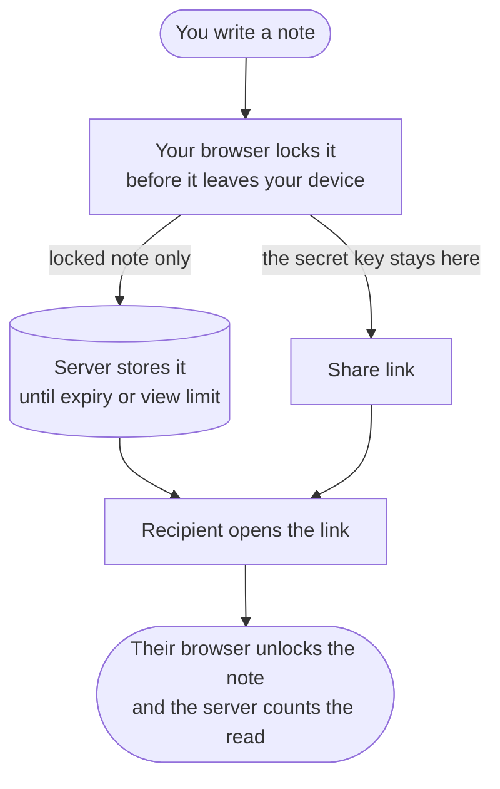

<div align="center">

<p align="center">
  
</p>

<h1 align="center"><strong>Say it once. <em>Sealed.</em></strong></h1>

<p align="center">Zero-knowledge, end-to-end encrypted notes that disappear after a limited number of reads.</p>

<p align="center">
  <a href="https://binthere.gaury.dev">Try it live</a> ·
  <a href="https://www.npmjs.com/package/binthere">Install the CLI</a> ·
  <a href="./SPEC.md">Documentation</a> ·
  <a href="https://github.com/nxfu/binthere/issues">Report a bug</a>
</p>

</div>

[English](./README.md) | [简体中文](./README.zh-CN.md)

binthere is a zero-knowledge, end-to-end encrypted pastebin. Write a note, get a link,
share it — and the note self-destructs once it has been read the allowed number of times. Your browser encrypts
everything with AES-256-GCM **before** it leaves your device, so the server only ever holds
ciphertext it can't read. Think of it as a self-destructing envelope for text: secrets,
credentials, a private message, a snippet of code.

<p align="center">
  <a href="./.nvmrc"></a>
  
  
  
  <a href="./eslint.config.js"></a>
</p>

## Differences from upstream (nxfu/binthere)

This repository is a modified version of [nxfu/binthere](https://github.com/nxfu/binthere). The table below lists every difference; everything else behaves exactly as upstream.

| Aspect | Upstream (nxfu/binthere) | This fork |
| --- | --- | --- |
| View count | Fixed: one read, then burned | Free-form number (1..1000; cap adjustable via the `MAX_VIEWS` env var). Counting is atomic in the Durable Object; the note is destroyed only once the view limit is reached |
| Expiry | Fixed: 24 hours | Free-form (minutes / hours / days), from 60 seconds to 30 days (bounds adjustable via `MIN_TTL_SECONDS` / `MAX_TTL_SECONDS`); the default is still 24 hours |
| Create gate | Anyone can create pastes | Optional owner token: with the `CREATE_TOKEN_SHA256` secret set, creation requires an `X-Create-Token` header; without it, creation stays open exactly as upstream |
| Owner admin page | None | `/admin` lists all your links across devices (views left, expiry) with one-click revoke. The server stores only a metadata index (KV `idx:` records) — never contents or keys. Admin endpoints reject every request while no token secret is set |
| Notes (labels) | None | An optional note (≤ 100 characters) can be attached at creation to tell links apart; stored in plain text on the server as a label only, editable later from the admin page |
| Encryption format | Format v1 + AAD | Identical to upstream — existing links keep working. Opening a link still fetches only the cover info; content is retrieved only on an explicit confirm, so previews and crawlers never burn a view |

## Why binthere?

binthere is a clean-room rebuild inspired by [PrivateBin](https://privatebin.info)'s
zero-knowledge model — modern Web Crypto, a strict CSP, atomic burn-after-read, and a real
test suite, with the ~700 KB of jQuery/Bootstrap/zlib-WASM stripped out. It runs as a single
Cloudflare Worker (Static Assets + KV + a Durable Object), so hosting is cheap and there is no
server to maintain.

- **No accounts or user tracking.** binthere keeps only an anonymous aggregate count of
  successfully created pastes. It stores no visitor or paste identifiers for this count.
- **Nobody can recover a lost link.** Not even the operator — there is no key to look up. The
  link is the only copy of the key, by design. (The server keeps an owner-only metadata index
  for the admin page, but it holds no contents and no keys.)
- **Honest limits.** The server still sees IPs, timings, and ciphertext sizes (it's private,
  not anonymous), and like all in-browser crypto it trusts the code the site serves — the
  full threat model is in [`SECURITY.md`](./SECURITY.md) and summarized under
  [Limitations](#limitations).

Pick binthere if you want a paste service you can deploy in one command with nothing to
patch, back up, or keep online yourself.

## How it works

The whole design rests on one trick: **where the decryption key lives**. It travels in the
URL fragment — the part after `#` — which browsers never send to any server.



1. **You write a note.** Your browser generates a random 256-bit key and encrypts the note
   locally with AES-256-GCM — before any network request is made.
2. **Only ciphertext is uploaded.** The key is never sent; it's appended to your link after
   `#`. The server stores an opaque blob it has no way to read.
3. **You share the link.** It carries both the note's id and the key
   (`…/p/<id>#<key>`) — the link *is* the capability to read the note. Optionally, add a
   password: it's mixed into the key derivation, so neither the link nor the password alone
   can decrypt.
4. **The recipient opens it.** Their browser fetches the ciphertext, reads the key from the
   fragment, and decrypts locally. The server never sees plaintext at any point.

By default every note is still **one-time view** with a **24-hour** expiry, but both are
free-form: set any view count (1..1000) and any expiry (60 seconds..30 days) at creation.
Reads are consumed atomically (a Durable Object guarantees the count is exact, even under
simultaneous clicks); once the view limit is reached, everyone after gets `410 Gone`. Unread
notes self-delete when their expiry passes.

## Features

| Feature | Details |
| --- | --- |
| Zero-knowledge | Encryption and decryption happen only on your device (browser or [CLI](#cli)); the server stores opaque ciphertext and non-secret metadata. |
| Optional password | Layered on top of the URL key — neither alone can decrypt. |
| Burn-after-read | Notes allow a free-form number of reads (default 1, up to 1000), consumed atomically in the Durable Object; once the limit is reached, everyone else gets `410 Gone`. |
| Auto-expiry | Notes delete themselves at a free-form expiry (default 24 hours; 60 seconds..30 days). |
| Create-token gate (optional) | Set the `CREATE_TOKEN_SHA256` secret and only requests carrying a matching `X-Create-Token` header can create pastes. Unset, creation stays open. |
| Owner admin page | `/admin` lists your links across devices with views left and expiry, and can revoke any of them. The server keeps only a metadata index — no contents, no keys. |
| Notes | Attach a short plain-text label (≤ 100 characters) at creation to tell links apart; editable from the admin page. |
| Safe rendering | Auto-detected syntax highlighting and a safe Markdown subset (no raw HTML, sanitized links). All rendering is DOM-construction only — never `innerHTML`. |
| Sharing tools | Copy link, QR code, delete link. |
| Minimal surface | Strict CSP, self-hosted fonts, no third-party scripts, no analytics, no accounts. |

> [!NOTE]
> The wire format supports the full expiry range (5 minutes–1 year or never) and non-burn
> pastes. This fork's UI exposes free-form view counts and expiry within the configured bounds
> (see [Differences from upstream](#differences-from-upstream-nxfubinthere)); older links keep
> working.

## How it compares

All of these are solid zero-knowledge paste/secret tools — the difference is mostly in how
they are hosted and what they optimize for:

| Project | Server | Storage | Distinguishing traits |
| --- | --- | --- | --- |
| **binthere** | Cloudflare Worker (serverless, no origin server) | Workers KV + Durable Object | Frozen spec with test vectors, atomic burn-after-read, no client framework or build step |
| [PrivateBin](https://privatebin.info) | PHP | Filesystem / DB / S3 | Mature, many formats, discussions, i18n |
| [Yopass](https://github.com/jhaals/yopass) | Go | Memcached / Redis | Secret-sharing focus, CLI client |
| [cryptgeon](https://github.com/cupcakearmy/cryptgeon) | Rust | Redis | File sharing, view limits |

## Getting started

Requires Node.js ≥ 20 (`.nvmrc` pins 22).

```bash
npm install
npm run dev      # wrangler dev → http://127.0.0.1:8787
```

KV, the Durable Object, and rate limiting are all emulated locally — no Cloudflare account
needed for development.

| Command | Description |
| --- | --- |
| `npm run dev` | Local dev server at `http://127.0.0.1:8787` |
| `npm test` | Full Vitest suite: Worker/frontend in the real `workerd` runtime, then the CLI suite in Node |
| `npm run test:cli` | Just the CLI suite (`cli/`, plain Node environment) |
| `npm run test:watch` | Tests in watch mode |
| `npm run test:coverage` | Tests with coverage report |
| `npm run lint` | ESLint 9 (flat config) |
| `npm run kv:create` | Create the `PASTES` KV namespace (+ preview) |
| `npm run deploy` | Deploy to Cloudflare |

CI runs lint, a byte-for-byte test-vector diff, and the full suite.

## CLI

An official command-line client lives in [`cli/`](./cli) and is published to npm as
[`binthere`](https://www.npmjs.com/package/binthere). It implements the same frozen protocol
as the web client — encryption happens locally, only ciphertext is uploaded, and notes have
the same default **one read / 24 hours** lifecycle as the website. Zero runtime dependencies
(Node ≥ 20 built-ins only).

```bash
npm install -g binthere    # or try it without installing anything: npx binthere
```

A bare `binthere` opens an interactive full-screen menu; it also composes in pipelines
(`git diff | npx binthere` prints a share URL on stdout). See
[`cli/README.md`](./cli/README.md) for the full command reference, interactive-mode tour,
and security notes. Set `BINTHERE_NO_ANIMATION=1` to keep the colored TUI while disabling
non-essential motion. Globally installed copies can update themselves with `binthere update`.

## Self-hosting

You can run your own binthere — nothing about the design ties it to the public instance, and
there is no managed service in the loop. Because it's a single Cloudflare Worker (Static
Assets + KV + a Durable Object), it's **optimized for Cloudflare Workers** and one of its
biggest advantages is cost: a complete instance fits inside
[Cloudflare's free tier](https://developers.cloudflare.com/workers/platform/pricing/), so you
can host binthere **completely free**.

[](https://deploy.workers.cloudflare.com/?url=https://github.com/nxfu/binthere)

The button above clones the repo and provisions everything declared in
[`wrangler.toml`](./wrangler.toml) — the static assets, the `PASTES` KV binding, the
`BurnPaste` Durable Object + migration, and the `CREATE_RL` rate limiter — on your own
Cloudflare account. The importer creates fresh resources and rewrites the resource ids in
*your* copy of the config; the checked-in ids belong to the origin deployment and are
identifiers, not secrets.

If the one-click path ever misbehaves, the manual route below is the guaranteed fallback:

```bash
npm run kv:create        # create your own PASTES KV namespace (+ preview)
# paste the printed id / preview_id into wrangler.toml
npm run deploy           # creates the Worker, Durable Object, and rate limiter
```

<details>
<summary>Self-hosting checklist</summary>

- Replace the KV `id` / `preview_id` in `wrangler.toml` with your own (a pristine template is
  in [`wrangler.toml.example`](./wrangler.toml.example)).
- Update the hardcoded canonical URLs: `og:url` / `og:image` in `public/index.html` and
  `Canonical` in `public/.well-known/security.txt` point at `binthere.gaury.dev`; the
  footer and `security.txt` `Policy` point at `github.com/nxfu/binthere`.
- The link-preview card `public/opengraph.png` also has that domain printed on it. Edit
  [`tools/opengraph.html`](./tools/opengraph.html) and re-render with `node tools/render-og.mjs`
  (needs a local Chrome/Chromium; pass `--browser <path>` or set `$CHROME` if it isn't found).
- `npm run dev` works with placeholder KV ids — KV is emulated locally.
- Optional owner gate: set the `CREATE_TOKEN_SHA256` secret (the SHA-256 hex of your create
  token) to require an `X-Create-Token` header for paste creation and to enable the `/admin`
  page. The view-count cap and expiry bounds (`MAX_VIEWS`, `MIN_TTL_SECONDS`,
  `MAX_TTL_SECONDS`) can be tuned in `wrangler.toml`.
- **Cost note on `never` expiry:** the official clients default to 24-hour one-time
  notes, but the wire format (and the API) accepts `expire: "never"`. Such a paste is
  stored with no KV TTL and no Durable Object alarm — an unread burn note kept forever
  carries a small perpetual cost under SQLite-backed DO storage billing. If you expose
  `never` to third-party clients, decide whether to cap it or accept the standing cost.

</details>

## Architecture

| Piece | Role |
| --- | --- |
| Static Assets (`public/`) | SPA frontend, served directly by the Worker |
| Worker (`src/index.js`) | `/api/*` paste API — stores ciphertext, enforces size/rate/burn |
| KV (`PASTES`) | Normal pastes, with native TTL expiry |
| Durable Object (`BurnPaste`) | Burn-after-read pastes, atomic view counting |
| Rate Limiting binding | Abuse mitigation on paste creation (fail-open) |

See [`ARCHITECTURE.md`](./ARCHITECTURE.md) for the request path and [`SPEC.md`](./SPEC.md) for
the exact cryptographic protocol and paste format v1, including frozen test vectors.

<details>
<summary>HTTP API</summary>

The API only ever handles ciphertext — encryption happens in the client before `POST`, and
the key fragment never appears in any request. Full details in [`SPEC.md`](./SPEC.md) §10.

| Method & path | Purpose | Success | Errors |
| --- | --- | --- | --- |
| `POST /api/paste` | Create a paste (format v1 JSON); requires `X-Create-Token` when the create-token gate is on | `201` | `400` invalid · `401` bad/missing create token (gate on) · `413` too large · `429` rate-limited |
| `GET /api/paste/:id` | Fetch a paste (consumes a burn) | `200` | `404` missing/expired · `410` burned |
| `GET /api/paste/:id?meta=1` | Peek a burn head without consuming | `200` | `404` missing · `410` burned/expired |
| `DELETE /api/paste/:id` | Delete, with `X-Delete-Token` header | `200` | `400` missing token · `403` wrong token · `404` missing |
| `GET /api/stars` | Repo star count for the topbar badge (not part of the paste protocol) | `200` | `502` GitHub unavailable |
| `GET /api/admin/list` | List link metadata (views left, expiry, note); requires `X-Create-Token` | `200` | `401` bad/missing token, or `CREATE_TOKEN_SHA256` unset |
| `POST /api/admin/revoke` | Revoke a link immediately; requires `X-Create-Token` | `200` | `401` bad/missing token, or `CREATE_TOKEN_SHA256` unset |
| `POST /api/admin/note` | Set/edit a link's note; requires `X-Create-Token` | `200` | `401` bad/missing token, or `CREATE_TOKEN_SHA256` unset |

The delete token travels in a header — never in the URL — so it cannot land in request logs;
the server stores and compares only its SHA-256.

</details>

<details>
<summary>Project layout</summary>

```
public/            static frontend (CSP-clean; served by Workers Static Assets)
  index.html  css/styles.css  js/*.js  fonts/*.woff2  img/ (favicon.svg + png fallbacks + wordmark[-dark].svg)
  _headers  robots.txt  favicon.ico  opengraph.png  .well-known/security.txt
src/
  index.js         Worker: /api/paste routing + asset fallback
  burn-do.js       BurnPaste Durable Object (atomic burn-after-read)
  lib/             ids, storage routing, rate-limit wrapper, GitHub star proxy
test/              vitest suites (run in workerd) + genvectors.mjs (vector regenerator)
                   + vectors.expected.txt (pinned vector output, diffed in CI)
tools/             verify-vectors.py — independent Python cross-check of the frozen vectors
                   opengraph.html + render-og.mjs — source & renderer for public/opengraph.png
cli/               the npm-published CLI client (own package.json + Node-environment tests;
                   vendor/ mirrors public/js/{bytes,format,crypto,qrcode}.js, drift-tested)
SPEC.md SECURITY.md ARCHITECTURE.md
CHANGELOG.md CONTRIBUTING.md CODE_OF_CONDUCT.md LICENSE
```

`public/js/{bytes,crypto,format,markdown}.js` are shared: the browser imports them as static
assets and the Worker bundles the same files, so the paste format has a single source of truth.

</details>

## Limitations

Most of these are deliberate scope choices, not bugs. Know them before relying on binthere:

- **Not anonymous or metadata-free.** The server sees IP, timing, ciphertext size, and the
  non-secret `adata` (IVs, KDF params, format flags). It only cannot read your *plaintext*
  ([`SECURITY.md`](./SECURITY.md) §3).
- **No protection from a compromised deployment.** Decryption runs in JavaScript the server
  delivers, so a malicious or hacked host could serve code that leaks your key. In-browser E2E
  encryption trusts the origin ([`SECURITY.md`](./SECURITY.md) §4).
- **Lose the link, lose the note.** No accounts — the id + key exist only in the URL you
  share, and nobody, including you, can recover a lost link. For the admin page the server
  does keep an owner-only metadata index (id, timestamps, view counts, notes), but it holds
  no contents and no keys, so it cannot bring a note back.

<details>
<summary>More limitations</summary>

- **Burn passwords can be brute-forced offline.** The non-consuming peek returns the wrapped
  key so a password can be checked before the single read — someone who already has the URL
  secret can guess a weak password without burning the note. Use a strong password
  ([`SPEC.md`](./SPEC.md) §8 documents the trade-off).
- **Password KDF is PBKDF2-SHA256** (310k iterations), not a memory-hard KDF. Argon2id is on
  the roadmap.
- **View counts and expiry are free-form within bounds.** The UI accepts any view count
  (1..`MAX_VIEWS`) and any expiry (`MIN_TTL_SECONDS`..`MAX_TTL_SECONDS`); values outside the
  configured range are rejected.
- **English only.**
- **The rate limiter fails open** — it is abuse mitigation, not access control.
- **Canonical URLs are hardcoded** to the origin deployment; update them when self-hosting
  (see [Self-hosting](#self-hosting)).

</details>

## FAQ

<details>
<summary>Can the operator read my notes?</summary>

No. Content is encrypted with AES-256-GCM in your browser before upload; the server stores
only ciphertext and non-secret metadata. The decryption key lives in the URL fragment, which
browsers never send to the server. What the server *does* see (IP, timing, sizes) is spelled
out in [`SECURITY.md`](./SECURITY.md) §3.

</details>

<details>
<summary>I lost the link — can the note be recovered?</summary>

No. There are no accounts; the paste id and decryption key exist only in the URL. The
server's owner-only metadata index (timestamps, view counts, notes) holds no contents and no
keys, so without the link the ciphertext is unrecoverable — by design.

</details>

<details>
<summary>Why does my link say "expired or was already opened"?</summary>

The note's view limit was reached or it expired. Reads are consumed atomically, so once the
allowed number of reads is used up (including by you, if you open your own link), everyone
after gets `410 Gone`. Notes also self-delete when their expiry passes, even if never opened.

</details>

<details>
<summary>Does adding a password make the link safe to send in the clear?</summary>

It helps — the password is mixed into the key derivation, so the link alone cannot decrypt.
But someone holding the link can test passwords offline without burning the note, so a weak
password only slows them down. Use a strong password and send it over a different channel
([`SPEC.md`](./SPEC.md) §8).

</details>

<details>
<summary>What does the recipient need?</summary>

Just the link and any modern browser — Web Crypto (`SubtleCrypto`) is the only requirement.
No account, extension, or app.

</details>

<details>
<summary>Can I create pastes from a script or CLI?</summary>

Yes — the official CLI is published to npm: `npm install -g binthere` (or `npx binthere`).
It speaks the same frozen protocol as the web client and is tested against the same vectors;
see the [CLI section](#cli). Third-party clients are possible too: the HTTP API accepts only
ciphertext in paste format v1, and the frozen test vectors in [`SPEC.md`](./SPEC.md) make an
independent implementation verifiable.

</details>

## Roadmap

Roughly in priority order:

- [x] **Official CLI client** — shipped; on npm as
      [`binthere`](https://www.npmjs.com/package/binthere) (see [CLI](#cli))
- [ ] **Argon2id** as a versioned password-KDF option alongside PBKDF2 (spec-first: vectors before code)
- [ ] **File attachments** — encrypted binary blobs with size limits (likely R2 for large files)
- [ ] **Headless-browser CSP + render test** (Playwright) in CI, asserting zero CSP violations
      across the create/view/burn flows

## Security

binthere is a security-sensitive cryptographic application. The threat model, explicit
non-goals, and vulnerability-reporting process are in [`SECURITY.md`](./SECURITY.md); the
frozen protocol and paste format live in [`SPEC.md`](./SPEC.md).

> [!IMPORTANT]
> Report suspected vulnerabilities privately to [nxfu@proton.me](mailto:nxfu@proton.me)
> (see `SECURITY.md` §8). Do not open a public issue with exploit details.

## Contributing

Issues and PRs are welcome — see [`CONTRIBUTING.md`](./CONTRIBUTING.md). Two hard rules:

1. **Crypto is spec-first.** Any change to the protocol, paste format, or canonical AAD must
   update [`SPEC.md`](./SPEC.md) *first* — never silently — then regenerate the frozen vectors
   with `node test/genvectors.mjs` (and refresh `test/vectors.expected.txt`, which CI diffs
   byte-for-byte). Never hand-edit the pinned hexes in `test/crypto.test.js`.
2. **Keep the CSP strict and rendering XSS-safe.** No inline styles/scripts, no CDNs, no
   `innerHTML` on user content. New rendering paths need a case in `test/markdown.test.js`.

Run `npm run lint` and `npm test` before opening a PR; all suites run in the real `workerd`
runtime.

## Tech stack

- [Cloudflare Workers](https://workers.cloudflare.com/) — Static Assets, KV, Durable Objects, native rate limiting
- Vanilla JavaScript (native ES modules) — no framework, no bundler for the frontend
- [Web Crypto API](https://developer.mozilla.org/en-US/docs/Web/API/SubtleCrypto) — AES-256-GCM, PBKDF2-SHA256
- [Vitest](https://vitest.dev/) — Worker suites in the real `workerd` runtime, CLI suites in Node
- [ESLint 9](https://eslint.org/) — flat config

## Acknowledgements

- [PrivateBin](https://privatebin.info) — the zero-knowledge pastebin whose model this is a
  clean-room rebuild of
- [qrcode-generator](https://github.com/kazuhikoarase/qrcode-generator) by Kazuhiko Arase
  (MIT) — vendored in `public/js/qrcode.js` for offline, CSP-safe QR rendering
- [Newsreader](https://fonts.google.com/specimen/Newsreader) by Production Type,
  [Geist](https://vercel.com/font) by Vercel, and
  [JetBrains Mono](https://www.jetbrains.com/lp/mono/) by JetBrains (all SIL OFL 1.1) —
  self-hosted in `public/fonts/`; license texts in
  [`public/fonts/THIRD-PARTY-NOTICES.md`](./public/fonts/THIRD-PARTY-NOTICES.md)

## License

[MIT](./LICENSE) © 2026 nxfu

---

<p align="center">
  Built to be shared once and forgotten.<br>
  If binthere is useful to you, consider giving it a ⭐ — it helps others find it.
</p>
