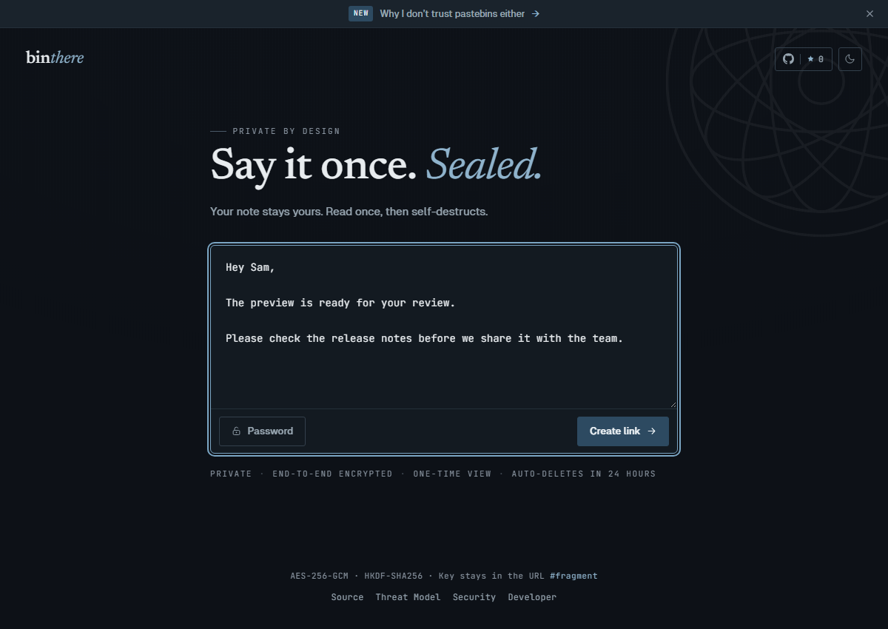
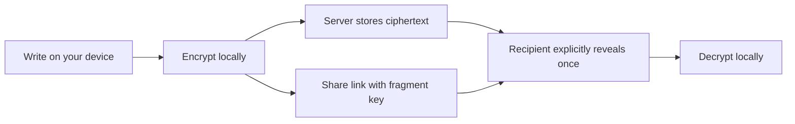

<div align="center">


<h1>Say it once. <em>Sealed.</em></h1>

End-to-end encrypted notes. One read. Up to 24 hours.

[**Open binthere**](https://binthere.gaury.dev) · [**CLI**](#cli) · [**Self-host**](SELF_HOSTING.md) · [**Security**](SECURITY.md) · [**Contribute**](CONTRIBUTING.md)

</div>

Write a note, create a link, and share it. The recipient explicitly reveals the note once;
unopened notes expire after 24 hours. Encryption and decryption happen on the user's device.
The server stores ciphertext and never receives the decryption key.



## Features

| Feature | What you get |
| --- | --- |
| Encryption on your device | AES-256-GCM, a fresh random key for every note, and a URL fragment that browsers do not send to the server. |
| Optional password | The full link and the password are both needed. Password verification happens before consuming the note. |
| One deliberate reveal | Metadata checks do not consume notes. An explicit read has exactly one successful consumer, even with concurrent requests. |
| Automatic expiry | Every new note expires after one read or 24 hours, whichever comes first. |
| Automatic formatting | Code and Markdown are detected after decryption. Markdown keeps single line breaks, with blank lines separating paragraphs; raw view and download are available. |
| Simple composer | Write a note and create its link, with an optional password. The 1 MiB text limit is checked on submission, with an error only if needed. |
| Sharing controls | Copy link, QR code, and a separate deletion token. Opening your own share link uses its one read. |
| Predictable failures | Bounded requests, preserved editor text after failed creation, and honest warnings when destructive outcomes are uncertain. |
| Browser and CLI | The same frozen v1 crypto format and test vectors; no client framework or third-party runtime service. |
| Independent hosting | One Cloudflare Worker with static assets, KV, and a SQLite-backed Durable Object. |

For [Discord-style subtext](https://support.discord.com/hc/en-us/articles/210298617-Markdown-Text-101-Chat-Formatting-Bold-Italic-Underline),
start a line with `-# ` (including the space). It renders as smaller, muted text and supports
the same inline emphasis, code, and safe links as ordinary Markdown. For example,
`-# A **small** note`. Markers inside code stay literal; normal single line breaks are preserved.

There are no accounts or visitor analytics. A public statistics endpoint reports a best-effort
aggregate of successfully stored new notes since statistics deployment. It receives no paste
IDs or content for counting, and cannot reconstruct past creations.

## How it works

1. **Write locally.** The browser or CLI encrypts the text before uploading it.
2. **Share the capability.** The link contains the note ID and a secret after `#`.
   The fragment stays on the client; the full link is the capability to decrypt the note.
3. **Check before revealing.** Opening a burn link fetches only metadata and a wrapped key.
   A missing/corrupt key or wrong password fails locally before the destructive read.
4. **Reveal once.** A deliberate consume request returns the ciphertext to one reader and
   removes the server's stored copy. The client decrypts it and clears the browser fragment.
   The recipient can still copy or save the resulting plaintext.



**Know the boundaries.** The operator still sees connection metadata such as IPs, timing,
and ciphertext sizes. Browser crypto trusts the JavaScript the deployment serves. Someone
with the full link can guess a weak password offline, and someone who reads the plaintext
can keep it. Lost links cannot be recovered. Read the [threat model](SECURITY.md) before
sharing sensitive material.

A timed-out consume may already have removed the note. The client never automatically
retries it or claims an abort rolled it back. A timed-out create can leave an inaccessible
note on the server; its text stays in the editor, and a deliberate retry may create another
copy. See [error semantics](ARCHITECTURE.md#error-semantics).

## Try it locally

Requires Git, Node.js 20 or later, and npm. `.nvmrc` selects Node 22.

```bash
git clone https://github.com/nxfu/binthere.git
cd binthere
npm ci
npm run dev
```

Open <http://127.0.0.1:8787>. KV and Durable Object storage run locally; a Cloudflare account
is not needed for this path. The native rate-limit binding is not emulated, so the application
fails open when it is unavailable. Dev and deploy commands apply the public site identity
configuration before starting; preview changes with `npm run configure-site -- --dry-run`.

## CLI

```bash
npm install -g binthere
binthere --help

# Create from stdin, a positional argument, or a file
git diff | binthere create
binthere create "Hello from the terminal"
binthere create --file note.txt --password

# Read a link from stdin without putting its secret fragment in command history
binthere get -

# Create machine-readable output; send only the share URL to the recipient
binthere create --text "A short note" --json
```

A bare `binthere` prints help and does not consume stdin. Creation always requires
`create`. The delete token is separate from the share link; `--quiet` suppresses creation
diagnostics, and `--json` returns the URL, ID, and deletion token. Keep the latter output
private if recipients should not be able to delete the note.

The CLI uses Node built-ins with zero runtime dependencies and the browser's vendored
crypto modules, checked byte for byte. Application and CLI releases are versioned separately.
See the [CLI reference](cli/README.md) for flags, self-hosted servers, file output,
passwords, exit codes, and updates.

## Self-hosting

Use your own Cloudflare account and fresh resource IDs. Start with the
[step-by-step self-hosting guide](SELF_HOSTING.md): it covers configuration, local checks,
deployment, custom domains, updates, troubleshooting, and verification.

[](https://deploy.workers.cloudflare.com/?url=https://github.com/nxfu/binthere)

The deployment button is an optional shortcut; the manual guide explains every required
binding and the first-deploy migration. Edit `public/site-config.json` to set your canonical
origin, repository links, developer/announcement links, and security contact. The domain in
the OpenGraph artwork must still be updated separately.

Low-traffic use may fit within Cloudflare's included allowances, but free hosting is not
guaranteed. Workers, KV, and Durable Objects have separate limits and billing rules; traffic
or exhausted quotas can cause charges on a paid plan or failures on a free plan. Review
[Workers pricing](https://developers.cloudflare.com/workers/platform/pricing/),
[KV pricing](https://developers.cloudflare.com/kv/platform/pricing/), and
[Durable Objects pricing](https://developers.cloudflare.com/durable-objects/platform/pricing/).
These are guidance for your own instance, not a claim about the maintainer's current bill.

## Architecture and API

| Piece | Responsibility |
| --- | --- |
| Static assets, `public/` | Native ES modules, strict CSP, self-hosted fonts; encryption, rendering, and UI. |
| Worker, `src/index.js` | Paste validation, routing, request limits, and read-only auxiliary endpoints. |
| `BurnPaste`, `src/burn-do.js` | Atomic one-time notes, expiry alarms, and independent aggregate-counter shards. |
| KV, `PASTES` | Reads/deletes for legacy reusable notes and the stored GitHub star snapshot. |
| Cron Trigger | Daily star refresh at 00:00 UTC, bounded through body parsing; visitors only read KV. |

| Request | Behavior |
| --- | --- |
| `POST /api/paste` | Create a v1, one-time, 24-hour note; returns 201 and an ID/deletion token. |
| `GET /api/paste/:id` | Read a legacy note or peek a burn note without consuming it. |
| `GET /api/paste/:id?meta=1` | Metadata peek without ciphertext or consumption. |
| `POST /api/paste/:id/consume` | Explicit one-time read with `X-Burn-Intent: consume`; one winner, later reads return 410. |
| `DELETE /api/paste/:id` | Delete using the `X-Delete-Token` header; returns no content. |
| `GET /api/statistics` | Best-effort aggregate count with a zero baseline and documented deployment scope. |
| `GET /api/stars` | Stored repository count, or 503 before initialization/unavailability; no live GitHub call. |

New reusable/custom-expiry notes are rejected. Legacy v1 links remain readable and deletable;
the reader's wider accepted format is a compatibility guarantee, not a creation option.
See [ARCHITECTURE.md](ARCHITECTURE.md) for data flow and
[SPEC.md](SPEC.md) for exact schemas, status codes, crypto, and frozen vectors.

## Development and verification

```bash
npm run lint
npm test                         # Worker, happy-dom, CLI, and Node tooling suites
npm run test:coverage             # Worker coverage and thresholds
npx playwright install chromium  # one-time local browser installation
npm run test:e2e                  # Chromium against an isolated local Worker
npm run configure-site -- --check
node cli/scripts/sync-shared.mjs --check
```

Browser tests cover creation/reveal/password/download flows, CSP, HTTP and body failures,
ambiguous destructive outcomes, timeouts, page lifecycle, keyboard controls, reduced motion,
narrow layouts, and composer boundaries. A mobile viewport is still Chromium; other browser
engines and production infrastructure require separate verification.

[CONTRIBUTING.md](CONTRIBUTING.md) explains runtimes, vectors, test setup, manual checks,
and releases. [CHANGELOG.md](CHANGELOG.md) records implemented changes. No frontend build
step is required; Wrangler bundles the Worker for deployment.

## Roadmap

This is a direction for maintenance and investigation, not a delivery schedule.

| Status | Direction |
| --- | --- |
| Planned maintenance | Keep frozen v1 browser/CLI compatibility, regression coverage, accessibility, and deployment documentation current. |
| Under consideration | Broader browser-engine verification after an explicit support policy is agreed. |
| Under consideration | A versioned memory-hard password KDF such as Argon2id, starting with threat-model review, benchmarks, and independent vectors. |
| Long-term exploration | Encrypted attachments, only after storage/size limits, one-time lifecycle, costs, and client interoperability are designed. |

## Contributing and security

Issues and focused PRs are welcome. Read [CONTRIBUTING.md](CONTRIBUTING.md),
[CODE_OF_CONDUCT.md](CODE_OF_CONDUCT.md), and the [security model](SECURITY.md) first.
Crypto changes are spec-first; keep strict CSP and DOM-only safe rendering intact.

Report suspected vulnerabilities privately to [nxfu@proton.me](mailto:nxfu@proton.me),
as described in [SECURITY.md](SECURITY.md). Do not post secret links or exploit details in
public issues.

## Acknowledgements and license

Inspired by [PrivateBin](https://privatebin.info)'s zero-knowledge model.
QR rendering vendors Kazuhiko Arase's MIT-licensed
[qrcode-generator](https://github.com/kazuhikoarase/qrcode-generator).
Newsreader, Geist, and JetBrains Mono are self-hosted; see
[font notices](public/fonts/THIRD-PARTY-NOTICES.md).

[MIT](LICENSE) © 2026 nxfu
