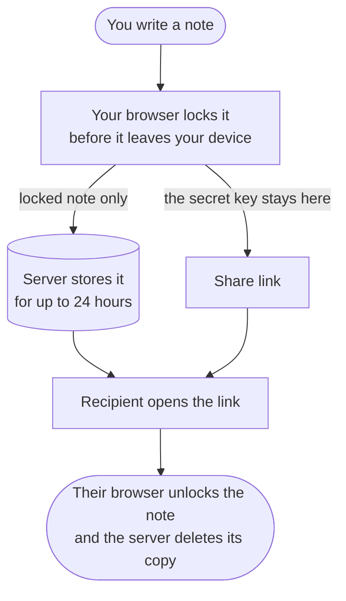

<div align="center">

<p align="center">
  
</p>

<h1 align="center"><strong>Say it once. <em>Sealed.</em></strong></h1>

<p align="center">Zero-knowledge, end-to-end encrypted notes that disappear after one read.</p>

<p align="center">
  <a href="https://binthere.gaury.dev">Try it live</a> ·
  <a href="https://www.npmjs.com/package/binthere">Install the CLI</a> ·
  <a href="./SPEC.md">Protocol documentation</a> ·
  <a href="./SELF_HOSTING.md">Self-hosting guide</a> ·
  <a href="https://github.com/nxfu/binthere/issues">Report a bug</a>
</p>

</div>

binthere is a zero-knowledge, end-to-end encrypted pastebin. Write a note, get a link,
share it — and the note self-destructs the moment it's read. Your browser encrypts
everything with AES-256-GCM **before** it leaves your device, so the server only ever holds
ciphertext it can't read. Think of it as a self-destructing envelope for text: secrets,
credentials, a private message, a snippet of code.

<p align="center">
  <a href="./.nvmrc"></a>
  
  
  
  <a href="./eslint.config.js"></a>
</p>

## Why binthere?

binthere is a clean-room rebuild inspired by [PrivateBin](https://privatebin.info)'s
zero-knowledge model — modern Web Crypto, a strict CSP, atomic burn-after-read, and a real
test suite, with the ~700 KB of jQuery/Bootstrap/zlib-WASM stripped out. It runs as a single
Cloudflare Worker (Static Assets + KV + a Durable Object), so hosting is cheap and there is no
server to maintain.

- **No accounts or user tracking.** binthere keeps only an anonymous aggregate count of
  successfully created pastes. It stores no visitor or paste identifiers for this count.
- **Nobody can recover a lost link.** Not even the operator — there is no key to look up and
  no index of pastes. The link is the only copy of the key, by design.
- **Honest limits.** The server still sees IPs, timings, and ciphertext sizes (it's private,
  not anonymous), and like all in-browser crypto it trusts the code the site serves — the
  full threat model is in [`SECURITY.md`](./SECURITY.md) and summarized under
  [Limitations](#limitations).

Pick binthere if you want a paste service you can deploy in one command with nothing to
patch, back up, or keep online yourself.

## How it works

The whole design rests on one trick: **where the decryption key lives**. It travels in the
URL fragment — the part after `#` — which browsers never send to any server.



1. **You write a note.** Your browser generates a random 256-bit key and encrypts the note
   locally with AES-256-GCM — before any network request is made.
2. **Only ciphertext is uploaded.** The key is never sent; it's appended to your link after
   `#`. The server stores an opaque blob it has no way to read.
3. **You share the link.** It carries both the note's id and the key
   (`…/p/<id>#<key>`) — the link *is* the capability to read the note. Optionally, add a
   password: it's mixed into the key derivation, so neither the link nor the password alone
   can decrypt.
4. **The recipient opens it.** Their browser fetches the ciphertext, reads the key from the
   fragment, and decrypts locally. The server never sees plaintext at any point.

Every note is **one-time view**: the first reader atomically consumes it (exactly one winner,
even under simultaneous clicks — a Durable Object guarantees it), and everyone after gets
`410 Gone`. Unread notes self-delete after 24 hours regardless.

## Features

| Feature | Details |
| --- | --- |
| Zero-knowledge | Encryption and decryption happen only on your device (browser or [CLI](#cli)); the server stores opaque ciphertext and non-secret metadata. |
| Optional password | Layered on top of the URL key — neither alone can decrypt. |
| Burn-after-read | Every note is a strict, atomic single-consumer read (Durable Object). The first reader gets it; everyone else gets `410 Gone`. |
| Auto-expiry | Every new note deletes itself after 24 hours. |
| Safe rendering | Auto-detected syntax highlighting and a safe Markdown subset (no raw HTML, sanitized links). All rendering is DOM-construction only — never `innerHTML`. |
| Sharing tools | Copy link, QR code, delete link. |
| Minimal surface | Strict CSP, self-hosted fonts, no third-party scripts, no visitor-level analytics, no accounts. |

> [!NOTE]
> New pastes always expire after 24 hours and burn after one read. The reader still supports
> older v1 links with different expiry or reusable behavior, but new ones cannot be created.

## How it compares

All of these are solid zero-knowledge paste/secret tools — the difference is mostly in how
they are hosted and what they optimize for:

| Project | Server | Storage | Distinguishing traits |
| --- | --- | --- | --- |
| **binthere** | Cloudflare Worker (serverless, no origin server) | Workers KV + Durable Object | Frozen spec with test vectors, atomic burn-after-read, no client framework or build step |
| [PrivateBin](https://privatebin.info) | PHP | Filesystem / DB / S3 | Mature, many formats, discussions, i18n |
| [Yopass](https://github.com/jhaals/yopass) | Go | Memcached / Redis | Secret-sharing focus, CLI client |
| [cryptgeon](https://github.com/cupcakearmy/cryptgeon) | Rust | Redis | File sharing, view limits |

## Getting started

Requires Node.js ≥ 20 (`.nvmrc` pins 22).

```bash
npm install
npm run dev      # wrangler dev → http://127.0.0.1:8787
```

KV and Durable Object storage are emulated locally, so ordinary development needs no
Cloudflare account. The native rate-limit binding is not emulated locally; requests fail open
when it is unavailable.

| Command | Description |
| --- | --- |
| `npm run dev` | Apply `public/site-config.json`, then start `http://127.0.0.1:8787` |
| `npm test` | Vitest suites: Worker/frontend in `workerd`, DOM rendering, and CLI in Node |
| `npm run test:e2e` | Playwright browser tests for CSP, create/reveal/burn, password retry, and download |
| `npm run test:cli` | Just the CLI suite (`cli/`, plain Node environment) |
| `npm run test:watch` | Tests in watch mode |
| `npm run test:coverage` | Tests with coverage report |
| `npm run lint` | ESLint 9 (flat config) |
| `npm run kv:create` | Create the `PASTES` KV namespace (+ preview) |
| `npm run configure-site` | Apply your site identity to crawler metadata and `security.txt` |
| `npm run deploy` | Apply site identity, then deploy to Cloudflare |

CI runs lint, a byte-for-byte test-vector diff, the Vitest suites, and the Playwright browser
flows.
To run the browser suite locally, install Chromium once with `npx playwright install chromium`.

## CLI

An official command-line client lives in [`cli/`](./cli) and is published to npm as
[`binthere`](https://www.npmjs.com/package/binthere). It implements the same frozen protocol
as the web client — encryption happens locally, only ciphertext is uploaded, and notes have
the same **one read / 24 hours** lifecycle as the website. Zero runtime dependencies
(Node ≥ 20 built-ins only).

```bash
npm install -g binthere    # or try it without installing anything: npx binthere
```

A bare `binthere` opens an interactive full-screen menu; it also composes in pipelines
(`git diff | npx binthere` prints a share URL on stdout). See
[`cli/README.md`](./cli/README.md) for the full command reference, interactive-mode tour,
and security notes. Set `BINTHERE_NO_ANIMATION=1` to keep the colored TUI while disabling
non-essential motion. Globally installed copies can update themselves with `binthere update`.

## Self-hosting

You can run an independent instance on your Cloudflare account. The repository includes a
manual setup with fresh KV namespaces and a SQLite-backed Durable Object; no maintainer
resource IDs are required. Cloudflare Free plan quotas may cover low-traffic personal use,
but usage limits, plan rules, and prices can change. Usage above included allowances may incur
charges or be limited. Review [Cloudflare Workers pricing](https://developers.cloudflare.com/workers/platform/pricing/)
before deploying.

[](https://deploy.workers.cloudflare.com/?url=https://github.com/nxfu/binthere)

For the manual, copy-ready setup, custom domain steps, cost notes, and verification checklist,
see the [self-hosting guide](./SELF_HOSTING.md). The optional one-click button provisions the
resources described by the deployment configuration; the manual guide explains how to create
and bind your own resources if you prefer to manage setup yourself.

## Architecture

| Piece | Role |
| --- | --- |
| Static Assets (`public/`) | SPA frontend, served directly by the Worker |
| Worker (`src/index.js`) | `/api/*` paste API — stores ciphertext, enforces size/rate/burn |
| KV (`PASTES`) | Read/delete compatibility for older v1 reusable pastes |
| Durable Object (`BurnPaste`) | Burn-after-read pastes, atomic single-consumer |
| Rate Limiting binding | Abuse mitigation on paste creation (fail-open) |

See [`ARCHITECTURE.md`](./ARCHITECTURE.md) for the request path and [`SPEC.md`](./SPEC.md) for
the exact cryptographic protocol and paste format v1, including frozen test vectors.

<details>
<summary>HTTP API</summary>

The API only ever handles ciphertext — encryption happens in the client before `POST`, and
the key fragment never appears in any request. Full details in [`SPEC.md`](./SPEC.md) §10.

| Method & path | Purpose | Success | Errors |
| --- | --- | --- | --- |
| `POST /api/paste` | Create a one-time, 24-hour paste (format v1 JSON) | `201` | `400` invalid/lifecycle unsupported · `413` too large · `429` rate-limited |
| `GET /api/paste/:id` | Fetch a legacy paste or peek a one-time note | `200` | `404` missing/expired · `410` burned |
| `GET /api/paste/:id?meta=1` | Peek a burn head without consuming | `200` | `404` missing · `410` burned/expired |
| `DELETE /api/paste/:id` | Delete, with `X-Delete-Token` header | `200` | `400` missing token · `403` wrong token · `404` missing |
| `GET /api/stars` | Stored repo star count for the topbar badge (not part of the paste protocol) | `200` | `503` snapshot unavailable or not initialized |
| `GET /api/statistics` | Aggregate successful paste creations since statistics deployment | `200` `{ "totalPastes": n, "baseline": 0, "scope": "..." }` | `503` statistics unavailable |

The delete token travels in a header — never in the URL — so it cannot land in request logs;
the server stores and compares only its SHA-256.

The paste counter is initialized to zero and counts from deployment onward; older consumed,
deleted, or expired pastes cannot be recovered from storage. Counter writes contain only an
anonymous increment and are best-effort, so a statistics storage failure never fails paste
creation. The endpoint is read-only and returns the same aggregate to every visitor.

</details>

<details>
<summary>Project layout</summary>

```
public/            static frontend (CSP-clean; served by Workers Static Assets)
  index.html  css/styles.css  js/*.js  fonts/*.woff2  img/ (favicon.svg + png fallbacks + wordmark[-dark].svg)
  _headers  robots.txt  favicon.ico  opengraph.png  .well-known/security.txt
src/
  index.js         Worker: /api/paste routing + asset fallback
  burn-do.js       BurnPaste Durable Object (atomic burn-after-read)
  lib/             ids, storage routing, rate-limit wrapper, GitHub star snapshot
test/              vitest suites (run in workerd) + genvectors.mjs (vector regenerator)
                   + vectors.expected.txt (pinned vector output, diffed in CI)
tools/             verify-vectors.py — independent Python cross-check of the frozen vectors
                   opengraph.html + render-og.mjs — source & renderer for public/opengraph.png
cli/               the npm-published CLI client (own package.json + Node-environment tests;
                   vendor/ mirrors public/js/{bytes,format,crypto,qrcode}.js, drift-tested)
SPEC.md SECURITY.md ARCHITECTURE.md
CHANGELOG.md CONTRIBUTING.md CODE_OF_CONDUCT.md LICENSE
```

`public/js/{bytes,crypto,format,markdown}.js` are shared: the browser imports them as static
assets and the Worker bundles the same files, so the paste format has a single source of truth.

</details>

## Limitations

Most of these are deliberate scope choices, not bugs. Know them before relying on binthere:

- **Not anonymous or metadata-free.** The server sees IP, timing, ciphertext size, and the
  non-secret `adata` (IVs, KDF params, format flags). It only cannot read your *plaintext*
  ([`SECURITY.md`](./SECURITY.md) §3).
- **No protection from a compromised deployment.** Decryption runs in JavaScript the server
  delivers, so a malicious or hacked host could serve code that leaks your key. In-browser E2E
  encryption trusts the origin ([`SECURITY.md`](./SECURITY.md) §4).
- **Lose the link, lose the note.** No accounts, no server-side index — the id + key exist only
  in the URL you share. Nobody, including you, can recover or list pastes.

<details>
<summary>More limitations</summary>

- **Burn passwords can be brute-forced offline.** The non-consuming peek returns the wrapped
  key so a password can be checked before the single read — someone who already has the URL
  secret can guess a weak password without burning the note. Use a strong password
  ([`SPEC.md`](./SPEC.md) §8 documents the trade-off).
- **Password KDF is PBKDF2-SHA256** (310k iterations), not a memory-hard KDF. Argon2id is on
  the roadmap.
- **New notes have a fixed lifecycle:** one read or 24 hours. Existing v1 links with legacy
  lifecycle settings remain readable.
- **English only.**
- **The rate limiter fails open** — it is abuse mitigation, not access control.
- **The OpenGraph card artwork** includes the origin domain; re-render it when self-hosting
  (see [Self-hosting](#self-hosting)).

</details>

## FAQ

<details>
<summary>Can the operator read my notes?</summary>

No. Content is encrypted with AES-256-GCM in your browser before upload; the server stores
only ciphertext and non-secret metadata. The decryption key lives in the URL fragment, which
browsers never send to the server. What the server *does* see (IP, timing, sizes) is spelled
out in [`SECURITY.md`](./SECURITY.md) §3.

</details>

<details>
<summary>I lost the link — can the note be recovered?</summary>

No. There are no accounts and no server-side index; the paste id and decryption key exist
only in the URL. Without it, the ciphertext is unrecoverable — by design.

</details>

<details>
<summary>Why does my link say "expired or was already opened"?</summary>

Every note is one-time view: the first reader atomically consumes it, and everyone after
(including you, if you open your own link first) gets `410 Gone`. Notes also self-delete
after 24 hours even if never opened.

</details>

<details>
<summary>Does adding a password make the link safe to send in the clear?</summary>

It helps — the password is mixed into the key derivation, so the link alone cannot decrypt.
But someone holding the link can test passwords offline without burning the note, so a weak
password only slows them down. Use a strong password and send it over a different channel
([`SPEC.md`](./SPEC.md) §8).

</details>

<details>
<summary>What does the recipient need?</summary>

Just the link and any modern browser — Web Crypto (`SubtleCrypto`) is the only requirement.
No account, extension, or app.

</details>

<details>
<summary>Can I create pastes from a script or CLI?</summary>

Yes — the official CLI is published to npm: `npm install -g binthere` (or `npx binthere`).
It speaks the same frozen protocol as the web client and is tested against the same vectors;
see the [CLI section](#cli). Third-party clients are possible too: the HTTP API accepts only
ciphertext in paste format v1, and the frozen test vectors in [`SPEC.md`](./SPEC.md) make an
independent implementation verifiable.

</details>

## Roadmap

Roughly in priority order:

- [x] **Official CLI client** — shipped; on npm as
      [`binthere`](https://www.npmjs.com/package/binthere) (see [CLI](#cli))
- [ ] **Argon2id** as a versioned password-KDF option alongside PBKDF2 (spec-first: vectors before code)
- [ ] **File attachments** — encrypted binary blobs with size limits (likely R2 for large files)
- [x] **Headless-browser CSP + render test** (Playwright) in CI, asserting zero CSP violations
      across the create/view/burn flows

## Security

binthere is a security-sensitive cryptographic application. The threat model, explicit
non-goals, and vulnerability-reporting process are in [`SECURITY.md`](./SECURITY.md); the
frozen protocol and paste format live in [`SPEC.md`](./SPEC.md).

> [!IMPORTANT]
> Report suspected vulnerabilities privately to [nxfu@proton.me](mailto:nxfu@proton.me)
> (see `SECURITY.md` §8). Do not open a public issue with exploit details.

## Contributing

Issues and PRs are welcome — see [`CONTRIBUTING.md`](./CONTRIBUTING.md). Two hard rules:

1. **Crypto is spec-first.** Any change to the protocol, paste format, or canonical AAD must
   update [`SPEC.md`](./SPEC.md) *first* — never silently — then regenerate the frozen vectors
   with `node test/genvectors.mjs` (and refresh `test/vectors.expected.txt`, which CI diffs
   byte-for-byte). Never hand-edit the pinned hexes in `test/crypto.test.js`.
2. **Keep the CSP strict and rendering XSS-safe.** No inline styles/scripts, no CDNs, no
   `innerHTML` on user content. New rendering paths need a case in `test/markdown.test.js`.

Run `npm run lint` and `npm test` before opening a PR; all suites run in the real `workerd`
runtime.

## Tech stack

- [Cloudflare Workers](https://workers.cloudflare.com/) — Static Assets, KV, Durable Objects, native rate limiting
- Vanilla JavaScript (native ES modules) — no framework, no bundler for the frontend
- [Web Crypto API](https://developer.mozilla.org/en-US/docs/Web/API/SubtleCrypto) — AES-256-GCM, PBKDF2-SHA256
- [Vitest](https://vitest.dev/) — Worker suites in the real `workerd` runtime, CLI suites in Node
- [ESLint 9](https://eslint.org/) — flat config

## Acknowledgements

- [PrivateBin](https://privatebin.info) — the zero-knowledge pastebin whose model this is a
  clean-room rebuild of
- [qrcode-generator](https://github.com/kazuhikoarase/qrcode-generator) by Kazuhiko Arase
  (MIT) — vendored in `public/js/qrcode.js` for offline, CSP-safe QR rendering
- [Newsreader](https://fonts.google.com/specimen/Newsreader) by Production Type,
  [Geist](https://vercel.com/font) by Vercel, and
  [JetBrains Mono](https://www.jetbrains.com/lp/mono/) by JetBrains (all SIL OFL 1.1) —
  self-hosted in `public/fonts/`; license texts in
  [`public/fonts/THIRD-PARTY-NOTICES.md`](./public/fonts/THIRD-PARTY-NOTICES.md)

## License

[MIT](./LICENSE) © 2026 nxfu

---

<p align="center">
  Built to be shared once and forgotten.<br>
  If binthere is useful to you, consider giving it a ⭐ — it helps others find it.
</p>
