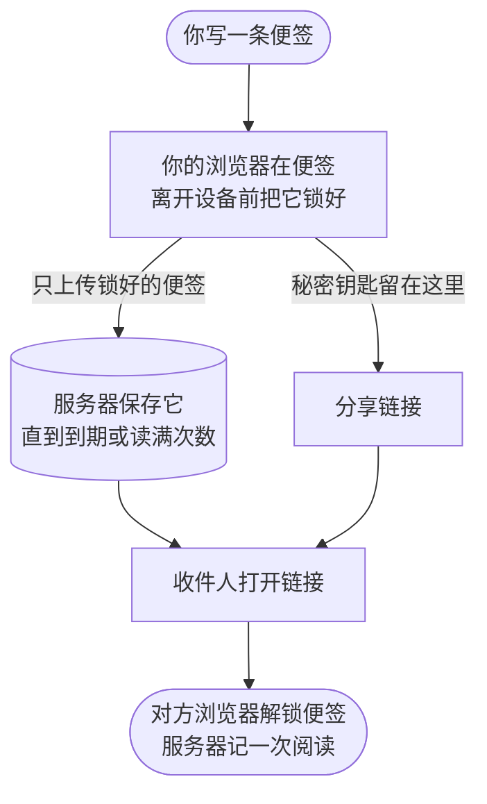

<div align="center">

<p align="center">
  
</p>

<h1 align="center"><strong>Say it once. <em>Sealed.</em></strong></h1>

<p align="center">零知识、端到端加密的便签，读满设定次数后消失。</p>

<p align="center">
  <a href="https://binthere.gaury.dev">在线体验</a> ·
  <a href="https://www.npmjs.com/package/binthere">安装 CLI</a> ·
  <a href="./SPEC.md">文档</a> ·
  <a href="https://github.com/nxfu/binthere/issues">报告问题</a>
</p>

</div>

[English](./README.md) | [简体中文](./README.zh-CN.md)

binthere 是一个零知识、端到端加密的 pastebin（文本分享服务）。写一条便签，拿到链接，
发出去——便签在被读满设定次数后自毁。你的浏览器在便签离开设备**之前**就用 AES-256-GCM
把它加密好，所以服务器永远只保存它读不懂的密文。可以把它想象成一个会自毁的文本信封：
用来传秘密、凭据、私人消息，或者一段代码。

<p align="center">
  <a href="./.nvmrc"></a>
  
  
  
  <a href="./eslint.config.js"></a>
</p>

## 与原版（nxfu/binthere）的差异

本仓库是 [nxfu/binthere](https://github.com/nxfu/binthere) 的修改版。下表列出全部差异，其余行为与原版完全一致。

| 方面 | 原版（nxfu/binthere） | 本修改版 |
| --- | --- | --- |
| 可读次数 | 固定：读 1 次即焚 | 可自由填数字（1..1000，上限由 env `MAX_VIEWS` 可调）。计数在 Durable Object 里原子完成，读满次数才销毁 |
| 有效期 | 固定：24 小时 | 可自由填（分钟 / 小时 / 天），范围 60 秒..30 天（上下限由 `MIN_TTL_SECONDS` / `MAX_TTL_SECONDS` 可调）；默认仍是 24 小时 |
| 建链门禁 | 任何人可建链 | 可选口令门禁：设置 `CREATE_TOKEN_SHA256` secret 后，建链须带 `X-Create-Token` 请求头；不设则与原版一样开放 |
| 主人管理页 | 没有 | `/admin` 跨设备列出你的全部链接（剩余次数、到期时间），可一键撤销。服务端只存元数据索引（KV `idx:` 记录），不存内容和钥匙。未设口令 secret 时，管理接口一律拒绝。注意：列表只显示元数据，不是可找回的分享链接——想在别的设备打开内容，仍须自己保存原链接。加索引功能之前创建的旧链接不在列表里 |
| 备注 | 没有 | 建链时可加备注（≤100 字）以便分辨链接；明文存服务器、仅作标签，之后可在管理页修改 |
| 加密格式 | 格式 v1 + AAD | 与原版完全一致——旧链接照常可用。打开链接仍只拿封面信息，点确认才取内容，所以预览和爬虫不会烧掉次数 |

## 为什么选 binthere？

binthere 是受 [PrivateBin](https://privatebin.info) 零知识模型启发的净室重写——现代
Web Crypto、严格的 CSP、原子性的阅后即焚、真正的测试套件，并去掉了约 700 KB 的
jQuery/Bootstrap/zlib-WASM。它以单个 Cloudflare Worker 运行（Static Assets + KV +
一个 Durable Object），托管成本低，也没有服务器要维护。

- **无账号、无用户追踪。** binthere 只保留一个匿名的成功创建计数，不为这个计数保存
  任何访客或 paste 标识符。
- **丢了链接谁也找不回。** 连运营者也不行——没有钥匙可查。链接是钥匙的唯一副本，
  这是设计使然。（服务器为管理页保存了仅主人可见的元数据索引，但其中不含内容和钥匙。）
- **诚实的局限。** 服务器仍能看到 IP、时间和密文大小（它是私密的，不是匿名的），
  而且和所有浏览器内加密一样，它信任站点下发的代码——完整威胁模型见
  [`SECURITY.md`](./SECURITY.md)，并在[局限性](#局限性)一节有摘要。

如果你想要一个一条命令就能部署、不用打补丁、不用备份、不用自己保持在线的 paste 服务，
选 binthere。

## 工作原理

整个设计只靠一个关键点：**解密钥匙放在哪**。它在 URL 的 fragment 里——就是 `#`
后面的部分——浏览器永远不会把这部分发给任何服务器。



1. **你写一条便签。** 浏览器生成一把随机的 256 位钥匙，在本地用 AES-256-GCM 加密
   便签——在发出任何网络请求之前。
2. **只上传密文。** 钥匙从不发送；它被拼在链接的 `#` 后面。服务器保存的是它无法
   读取的不透明数据块。
3. **你分享链接。** 链接同时带着便签 id 和钥匙（`…/p/<id>#<key>`）——链接本身就是
   读取便签的凭证。还可以再加一个密码：密码会混入钥匙派生，所以单独有链接或单独
   知道密码都解不开。
4. **收件人打开它。** 对方浏览器取回密文，从 fragment 里读出钥匙，在本地解密。
   服务器在任何环节都看不到明文。

默认每条便签仍是**只读一次**、**24 小时**过期，但两者都可自由设定：创建时可填任意
可读次数（1..1000）和任意有效期（60 秒..30 天）。阅读以原子方式计数（Durable Object
保证计数准确，哪怕同时点击），次数读满后，后来的人拿到 `410 Gone`。没人读的便签
会在到期时自删。

## 功能

| 功能 | 说明 |
| --- | --- |
| 零知识 | 加密和解密只在你的设备上进行（浏览器或 [CLI](#cli)）；服务器只存不透明的密文和非秘密的元数据。 |
| 可选密码 | 叠加在 URL 钥匙之上——单独任何一个都解不开。 |
| 阅后即焚 | 便签可自由设定可读次数（默认 1，上限 1000），在 Durable Object 里原子计数；次数读满后，其余人拿到 `410 Gone`。 |
| 自动过期 | 便签在自由设定的有效期到达时自删（默认 24 小时；60 秒..30 天）。 |
| 建链口令门禁（可选） | 设置 `CREATE_TOKEN_SHA256` secret 后，只有带匹配 `X-Create-Token` 请求头的请求能建链。不设则保持开放。 |
| 主人管理页 | `/admin` 跨设备列出你的链接（剩余次数、到期时间），并可撤销任意一条。服务器只保存元数据索引——不存内容，不存钥匙。 |
| 备注 | 创建时可附一条简短的明文标签（≤100 字）以便分辨链接；可在管理页修改。 |
| 安全渲染 | 自动检测语法高亮和安全的 Markdown 子集（无原始 HTML、链接经消毒）。所有渲染只用 DOM 构造——绝不用 `innerHTML`。 |
| 分享工具 | 复制链接、二维码、删除链接。 |
| 极小攻击面 | 严格 CSP、自托管字体、无第三方脚本、无分析统计、无账号。 |

> [!NOTE]
> 线路格式本身接受完整的过期范围（5 分钟–1 年或永不过期）和非焚毁 paste，但本修改版的
> 创建接口更严：每条新 paste 必须是焚毁类、有效期为 60 秒..30 天内的整数（上下限由 env
> 可调），所以经 API 建不出永不过期、非焚毁或超过 30 天的 paste。在此范围内，UI 开放了
> 自由次数和自由有效期（见[与原版的差异](#与原版nxfubinthere的差异)）；旧链接继续可用。

## 与同类项目对比

这些都是扎实的零知识 paste/秘密分享工具——差别主要在托管方式和优化取向：

| 项目 | 服务器 | 存储 | 特点 |
| --- | --- | --- | --- |
| **binthere** | Cloudflare Worker（无服务器，无源站） | Workers KV + Durable Object | 冻结的规范带测试向量、原子性阅后即焚、无客户端框架和构建步骤 |
| [PrivateBin](https://privatebin.info) | PHP | 文件系统 / 数据库 / S3 | 成熟、格式多、支持讨论、支持多语言 |
| [Yopass](https://github.com/jhaals/yopass) | Go | Memcached / Redis | 专注秘密分享、有 CLI 客户端 |
| [cryptgeon](https://github.com/cupcakearmy/cryptgeon) | Rust | Redis | 文件分享、阅读次数限制 |

## 快速开始

需要 Node.js ≥ 20（`.nvmrc` 固定为 22）。

```bash
npm install
npm run dev      # wrangler dev → http://127.0.0.1:8787
```

KV、Durable Object 和限流都在本地模拟——开发不需要 Cloudflare 账号。

| 命令 | 说明 |
| --- | --- |
| `npm run dev` | 本地开发服务器，地址 `http://127.0.0.1:8787` |
| `npm test` | 完整 Vitest 套件：Worker/前端在真正的 `workerd` 运行时里跑，然后是 Node 里的 CLI 套件 |
| `npm run test:cli` | 只跑 CLI 套件（`cli/`，纯 Node 环境） |
| `npm run test:watch` | 监视模式跑测试 |
| `npm run test:coverage` | 带覆盖率报告跑测试 |
| `npm run lint` | ESLint 9（flat config） |
| `npm run kv:create` | 创建 `PASTES` KV 命名空间（+ 预览） |
| `npm run deploy` | 部署到 Cloudflare |

CI 会跑 lint、逐字节的测试向量 diff 和完整套件。

## CLI

官方命令行客户端在 [`cli/`](./cli)，已发布到 npm，包名
[`binthere`](https://www.npmjs.com/package/binthere)。它实现与网页客户端相同的冻结
协议——加密在本地进行，只上传密文，便签默认与网站相同的**读 1 次 / 24 小时**生命周期。
零运行时依赖（只用 Node ≥ 20 内置模块）。

```bash
npm install -g binthere    # 或免安装直接试：npx binthere
```

裸跑 `binthere` 会打开交互式全屏菜单；它也能进管道
（`git diff | npx binthere` 在 stdout 打印分享 URL）。完整命令参考、交互模式导览和
安全说明见 [`cli/README.md`](./cli/README.md)。设 `BINTHERE_NO_ANIMATION=1` 可保留
彩色 TUI 但关掉非必要动画。全局安装的副本可用 `binthere update` 自更新。

## 自建部署

你可以运行自己的 binthere——这个设计不绑定公共实例，中间也没有托管服务。因为它是
单个 Cloudflare Worker（Static Assets + KV + 一个 Durable Object），它**为 Cloudflare
Workers 优化**，最大优势之一是成本：一个完整实例装得进
[Cloudflare 免费额度](https://developers.cloudflare.com/workers/platform/pricing/)，
所以你可以**完全免费**托管 binthere。

[](https://deploy.workers.cloudflare.com/?url=https://github.com/nxfu/binthere)

上面的按钮会克隆仓库并在你的 Cloudflare 账号上开通
[`wrangler.toml`](./wrangler.toml) 里声明的一切——静态资源、`PASTES` KV 绑定、
`BurnPaste` Durable Object + 迁移、`CREATE_RL` 限流器。导入器会新建资源，并把
资源 id 改写进*你那份*配置；仓库里提交的 id 属于源部署，它们是标识符，不是秘密。

如果一键路径出问题，下面的手动路线是保证可用的兜底：

```bash
npm run kv:create        # 创建你自己的 PASTES KV 命名空间（+ 预览）
# 把打印出的 id / preview_id 填进 wrangler.toml
npm run deploy           # 创建 Worker、Durable Object 和限流器
```

<details>
<summary>自建部署清单</summary>

- 把 `wrangler.toml` 里的 KV `id` / `preview_id` 换成你自己的（干净模板在
  [`wrangler.toml.example`](./wrangler.toml.example)）。
- 更新写死的规范 URL：`public/index.html` 里的 `og:url` / `og:image` 和
  `public/.well-known/security.txt` 里的 `Canonical` 指向 `binthere.gaury.dev`；
  页脚和 `security.txt` 的 `Policy` 指向 `github.com/nxfu/binthere`。
- 链接预览卡 `public/opengraph.png` 上也印着那个域名。编辑
  [`tools/opengraph.html`](./tools/opengraph.html) 后用 `node tools/render-og.mjs`
  重新渲染（需要本地 Chrome/Chromium；找不到时传 `--browser <path>` 或设 `$CHROME`）。
- `npm run dev` 用占位 KV id 就能跑——KV 在本地模拟。
- 可选的主人门禁：设置 `CREATE_TOKEN_SHA256` secret（你的建链口令的 SHA-256 十六进制值），
  即可要求建链带 `X-Create-Token` 请求头并启用 `/admin` 页。可读次数上限和有效期上下限
  （`MAX_VIEWS`、`MIN_TTL_SECONDS`、`MAX_TTL_SECONDS`）可在 `wrangler.toml` 里调。
- **API 不支持 `never` 过期：** 创建时必须给出配置上下限内的整数 TTL
  （`MIN_TTL_SECONDS`..`MAX_TTL_SECONDS`，默认 60 秒..30 天）。旧格式的
  `expire: "never"` 映射为 TTL 0，会被创建接口以 `400` 拒绝，所以经 API 建不出
  无限期记录（没有无 TTL / 无 alarm 的 paste）。

</details>

## 架构

| 部件 | 职责 |
| --- | --- |
| Static Assets（`public/`） | SPA 前端，由 Worker 直接提供 |
| Worker（`src/index.js`） | `/api/*` paste API——存密文，强制大小/限流/焚毁规则 |
| KV（`PASTES`） | 普通 paste，带原生 TTL 过期 |
| Durable Object（`BurnPaste`） | 阅后即焚 paste，原子计数 |
| Rate Limiting 绑定 | 建链防滥用（失败时放行） |

请求路径见 [`ARCHITECTURE.md`](./ARCHITECTURE.md)；确切的加密协议和 paste 格式 v1
（包括冻结的测试向量）见 [`SPEC.md`](./SPEC.md)。

<details>
<summary>HTTP API</summary>

API 永远只处理密文——加密在客户端 `POST` 之前完成，钥匙 fragment 从不出现在任何
请求里。完整细节见 [`SPEC.md`](./SPEC.md) §10。

| 方法与路径 | 用途 | 成功 | 错误 |
| --- | --- | --- | --- |
| `POST /api/paste` | 创建 paste（格式 v1 JSON）；开启建链门禁时须带 `X-Create-Token` | `201` | `400` 无效 · `401` 口令缺失/错误（门禁开启时） · `413` 太大 · `429` 限流 |
| `GET /api/paste/:id` | 取 paste（焚毁类只回封面信息，不消耗） | `200` | `404` 不存在/已过期 · `410` 已焚毁/已过期 |
| `GET /api/paste/:id?meta=1` | 只看焚毁便签的封面信息，不消耗次数 | `200` | `404` 不存在 · `410` 已焚毁/已过期 |
| `POST /api/paste/:id/consume` | 消耗一次阅读（焚毁类）；须带 `X-Burn-Intent: consume` 请求头 | `200` | `400` 缺请求头 · `403` 跨站 · `404` 不存在/非焚毁类 · `410` 已焚毁/已过期 |
| `DELETE /api/paste/:id` | 删除，带 `X-Delete-Token` 请求头 | `200` | `400` 缺 token · `403` token 错误 · `404` 不存在 |
| `GET /api/stars` | 顶栏徽章用的仓库星数（不属于 paste 协议） | `200` | `502` GitHub 不可用 |
| `GET /api/admin/list` | 列出链接元数据（剩余次数、到期时间、备注）；须带 `X-Create-Token` | `200` | `401` 口令缺失/错误，或未设 `CREATE_TOKEN_SHA256` |
| `POST /api/admin/revoke` | 立即撤销一条链接；须带 `X-Create-Token` | `200` | `401` 口令缺失/错误，或未设 `CREATE_TOKEN_SHA256` |
| `POST /api/admin/note` | 设置/修改一条链接的备注；须带 `X-Create-Token` | `200` | `401` 口令缺失/错误，或未设 `CREATE_TOKEN_SHA256` |

删除 token 走请求头——从不在 URL 里——所以不会落进请求日志；服务器只保存和比对它的
SHA-256。

</details>

<details>
<summary>项目结构</summary>

```
public/            static frontend (CSP-clean; served by Workers Static Assets)
  index.html  css/styles.css  js/*.js  fonts/*.woff2  img/ (favicon.svg + png fallbacks + wordmark[-dark].svg)
  _headers  robots.txt  favicon.ico  opengraph.png  .well-known/security.txt
src/
  index.js         Worker: /api/paste routing + asset fallback
  burn-do.js       BurnPaste Durable Object (atomic burn-after-read)
  lib/             ids, storage routing, rate-limit wrapper, GitHub star proxy
test/              vitest suites (run in workerd) + genvectors.mjs (vector regenerator)
                   + vectors.expected.txt (pinned vector output, diffed in CI)
tools/             verify-vectors.py — independent Python cross-check of the frozen vectors
                   opengraph.html + render-og.mjs — source & renderer for public/opengraph.png
cli/               the npm-published CLI client (own package.json + Node-environment tests;
                   vendor/ mirrors public/js/{bytes,format,crypto,qrcode}.js, drift-tested)
SPEC.md SECURITY.md ARCHITECTURE.md
CHANGELOG.md CONTRIBUTING.md CODE_OF_CONDUCT.md LICENSE
```

`public/js/{bytes,crypto,format,markdown}.js` 是共享的：浏览器把它们当静态资源导入，
Worker 打包同一批文件，所以 paste 格式只有一个事实来源。

</details>

## 局限性

多数是刻意取舍，不是 bug。依赖 binthere 之前先了解它们：

- **不匿名、不是无元数据。** 服务器能看到 IP、时间、密文大小和非秘密的 `adata`
  （IV、KDF 参数、格式标志）。它只是读不了你的*明文*（[`SECURITY.md`](./SECURITY.md) §3）。
- **防不了部署被攻破。** 解密跑在服务器下发的 JavaScript 里，所以恶意或被黑的主机
  可以下发泄露你钥匙的代码。浏览器内端到端加密信任源站
  （[`SECURITY.md`](./SECURITY.md) §4）。
- **丢了链接，丢了便签。** 无账号——解密钥匙只存在于你分享的 URL 里，谁（包括你）
  都找不回丢了的链接。服务器为管理页保存了仅主人可见的元数据索引（编号、时间、
  次数、备注），但其中不含内容和钥匙，所以它也找不回便签。

<details>
<summary>更多局限</summary>

- **焚毁便签的密码可被离线爆破。** 不消耗次数的封面查询会返回被包裹的钥匙，以便在
  唯一一次阅读前校验密码——已经拿到 URL 秘密的人可以猜弱密码而不烧掉便签。请用
  强密码（[`SPEC.md`](./SPEC.md) §8 记录了这个取舍）。
- **密码 KDF 是 PBKDF2-SHA256**（31 万次迭代），不是内存硬 KDF。Argon2id 在路线图上。
- **可读次数和有效期在上下限内自由设定。** UI 接受任意可读次数（1..`MAX_VIEWS`）和
  任意有效期（`MIN_TTL_SECONDS`..`MAX_TTL_SECONDS`）；超出配置范围的值会被拒绝。
- **仅英文界面。**
- **限流器失败时放行**——它是防滥用手段，不是访问控制。
- **规范 URL 写死**为源部署；自建时请更新（见[自建部署](#自建部署)）。

</details>

## 常见问题

<details>
<summary>运营者能读我的便签吗？</summary>

不能。内容在上传前已在你的浏览器里用 AES-256-GCM 加密；服务器只存密文和非秘密的
元数据。解密钥匙在 URL fragment 里，浏览器从不把它发给服务器。服务器*能*看到的
（IP、时间、大小）在 [`SECURITY.md`](./SECURITY.md) §3 里写明了。

</details>

<details>
<summary>链接丢了——便签还能找回吗？</summary>

不能。没有账号；解密钥匙只存在于 URL 里。服务器仅主人可见的元数据索引
（时间、次数、备注）不含内容和钥匙，所以没有链接，密文不可恢复——这是设计使然。

</details>

<details>
<summary>为什么我的链接说「已过期或已被打开」？</summary>

便签的可读次数用完了，或者它过期了。阅读以原子方式计数，所以允许的阅读次数一旦
用完（包括你自己先打开了自己的链接），后来的人都拿到 `410 Gone`。便签也会在到期
时自删，哪怕从没被打开过。

</details>

<details>
<summary>加了密码，链接就能明文发送了吗？</summary>

有帮助——密码混入了钥匙派生，所以光有链接解不开。但持有链接的人可以离线试密码
而不烧掉便签，所以弱密码只是拖慢他们。请用强密码，并通过另一条渠道发送
（[`SPEC.md`](./SPEC.md) §8）。

</details>

<details>
<summary>收件人需要什么？</summary>

只要链接和任意现代浏览器——唯一要求是 Web Crypto（`SubtleCrypto`）。
不需要账号、扩展或 App。

</details>

<details>
<summary>能用脚本或 CLI 创建 paste 吗？</summary>

能——官方 CLI 已发布到 npm：`npm install -g binthere`（或 `npx binthere`）。
它与网页客户端说同一套冻结协议，并用同一批向量测试；见 [CLI 一节](#cli)。第三方
客户端也可以：HTTP API 只接受 paste 格式 v1 的密文，[`SPEC.md`](./SPEC.md) 里冻结
的测试向量让独立实现可验证。

</details>

## 路线图

大致按优先级：

- [x] **官方 CLI 客户端**——已发布；在 npm 上叫
      [`binthere`](https://www.npmjs.com/package/binthere)（见 [CLI](#cli)）
- [ ] **Argon2id** 作为 PBKDF2 之外的版本化密码 KDF 选项（规范先行：先有向量再写代码）
- [ ] **文件附件**——带大小上限的加密二进制块（大文件可能用 R2）
- [ ] **无头浏览器 CSP + 渲染测试**（Playwright）进 CI，断言创建/查看/焚毁流程零 CSP 违规

## 安全

binthere 是安全敏感的加密应用。威胁模型、明确的非目标和漏洞报告流程在
[`SECURITY.md`](./SECURITY.md)；冻结的协议和 paste 格式在 [`SPEC.md`](./SPEC.md)。

> [!IMPORTANT]
> 疑似漏洞请私下报告给 [nxfu@proton.me](mailto:nxfu@proton.me)
> （见 `SECURITY.md` §8）。不要开带利用细节的公开 issue。

## 参与贡献

欢迎 issue 和 PR——见 [`CONTRIBUTING.md`](./CONTRIBUTING.md)。两条硬规矩：

1. **加密改动规范先行。** 任何对协议、paste 格式或规范 AAD 的改动必须*先*更新
   [`SPEC.md`](./SPEC.md)——绝不悄悄改——然后用 `node test/genvectors.mjs` 重新生成
   冻结向量（并刷新 `test/vectors.expected.txt`，CI 会逐字节 diff）。绝不要手改
   `test/crypto.test.js` 里钉死的十六进制值。
2. **保持 CSP 严格、渲染防 XSS。** 无内联样式/脚本、无 CDN、用户内容不用
   `innerHTML`。新的渲染路径要在 `test/markdown.test.js` 里加用例。

开 PR 前跑 `npm run lint` 和 `npm test`；所有套件都在真正的 `workerd` 运行时里跑。

## 技术栈

- [Cloudflare Workers](https://workers.cloudflare.com/)——Static Assets、KV、Durable Objects、原生限流
- 原生 JavaScript（原生 ES 模块）——前端无框架、无打包器
- [Web Crypto API](https://developer.mozilla.org/en-US/docs/Web/API/SubtleCrypto)——AES-256-GCM、PBKDF2-SHA256
- [Vitest](https://vitest.dev/)——Worker 套件在真正的 `workerd` 运行时里跑，CLI 套件在 Node 里跑
- [ESLint 9](https://eslint.org/)——flat config

## 致谢

- [PrivateBin](https://privatebin.info)——本项目净室重写的零知识 pastebin 原型
- [qrcode-generator](https://github.com/kazuhikoarase/qrcode-generator)，作者 Kazuhiko Arase
  （MIT）——vendored 在 `public/js/qrcode.js`，用于离线、CSP 安全的二维码渲染
- [Newsreader](https://fonts.google.com/specimen/Newsreader)（Production Type）、
  [Geist](https://vercel.com/font)（Vercel）、
  [JetBrains Mono](https://www.jetbrains.com/lp/mono/)（JetBrains）（均为 SIL OFL 1.1）——
  自托管在 `public/fonts/`；许可文本在
  [`public/fonts/THIRD-PARTY-NOTICES.md`](./public/fonts/THIRD-PARTY-NOTICES.md)

## 许可证

[MIT](./LICENSE) © 2026 nxfu

---

<p align="center">
  为分享一次、然后被遗忘而建。<br>
  如果 binthere 对你有用，考虑给它一颗 ⭐——这能帮其他人找到它。
</p>
